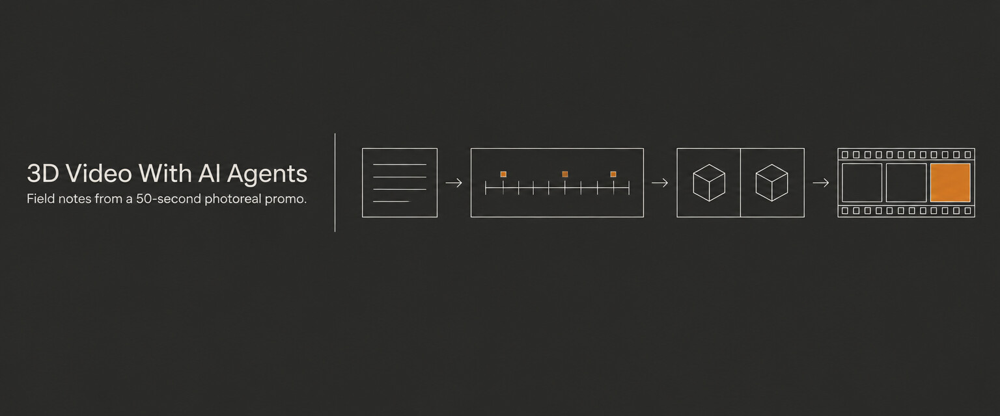
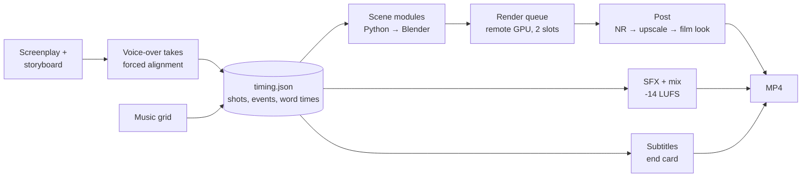

<p align="center">
  
</p>

<h1 align="center">3D Video With AI Agents</h1>

<p align="center">
  What I learned directing Claude Code agents to make a 50-second photoreal 3D promo, packaged as an agent skill.
</p>

<p align="center">
  <a href="#install-the-skill"><b>Install the skill</b></a> ·
  <a href="#the-lessons">The lessons</a> ·
  <a href="#architecture">Architecture</a> ·
  <a href="references/09-cost.md">Where the tokens went</a>
</p>

<p align="center">
  
</p>

## Why

I wanted to know whether coding agents can make a real product video, not a slideshow: photoreal 3D, physics,
camera moves, voice-over, music, sound effects, subtitles. So I gave Claude Code a screenplay, an 8-panel storyboard
and a home GPU, and directed it in chat for four days.

It worked. Eight cuts later the film was 49.5 seconds, 1,189 frames, rendered in headless Blender on an RTX 3060 Ti
and finished in Python and ffmpeg. It also cost about $964 in its first session at API list prices, a third of that
spent on agents waiting for renders, and most of the early polish was thrown away by story notes I could only give
once I saw the whole film. This repo is what I'd tell an agent, or myself, before starting the next one.

The client and product are not named, and no script or brand material is included. The lessons are general.

## What's inside

- **A skill any coding agent can load.** [`SKILL.md`](SKILL.md) holds the 12 rules that mattered most and a turn-1
  checklist; it points to the details only when needed.
- **Eleven reference notes with the evidence.** Each rule comes with what happened, the numbers, and how to apply it.
- **Templates.** A [timing file](templates/timing.example.json) that drives picture, sound and subtitles, and the
  [agent brief](templates/agent-brief.md) format that made parallel rounds work.
- **Two small scripts.** [`partial_rerender.py`](scripts/partial_rerender.py) seeds a new cut from the previous one
  with hardlinks, renumbering and gaps for changed frames. [`seam_check.py`](scripts/seam_check.py) flags frame
  jumps where re-rendered frames meet reused ones.

## The project in numbers

| | |
|---|---|
| Final film | 49.5 s, 1,189 frames at 24 fps, 1920x1080 (2.39:1 picture), -14 LUFS |
| Cuts delivered | 8 in about four days |
| Render | 50% resolution (960x402) on an RTX 3060 Ti, ~5-10 s per frame, Lanczos upscale |
| Full re-render | ~2.5-3 h. Later cuts re-rendered 0, 280 and 485 frames |
| First session | ~$964 at list prices, 8,481 API calls, 99% on the strongest model |
| Agents waiting on renders | 34% of that first session (cache rewrites after 5 min idle) |
| After the fix | idle rewrites 8-10% of each later session |
| Last four feedback rounds | ~$98 in total; one critic pass $1.4-2 |

## The lessons

The twelve below are the ones I'd pay for again. Each links to its reference note.

1. **Show a full-length rough cut within hours.** I first saw the whole film ~25 hours in, after ~$650 of
   build-and-critic loops. My first viewing produced the notes that mattered: a jarring cut, a "sterile" set, the
   product hidden in a black box, scenes too short to read. → [plan and story](references/01-plan-and-story.md)
2. **One timing file drives everything.** Shots, named events, voice-over word times and the music grid in one JSON.
   Keys written as `event + offset`, never frame literals. Picture keyed to spoken words is what fixed
   "incoherent". → [timing contract](references/02-timing-contract.md)
3. **Plan before acting on subjective feedback.** Findings with frame numbers, numbered changes, an agent table, the
   frames that re-render, defaults for open decisions. Every plan in that shape got "Approve, go" first time.
4. **Never let an agent wait inside its own context.** Detached jobs, bounded waits under the 5-minute cache, a
   zero-token background waiter for the main thread, hooks that block sleep loops. → [cost](references/09-cost.md)
5. **Real assets for surfaces, code for structure.** Procedural materials plateaued; scanned CC0 textures fixed them.
   Free libraries had the dressing but not the hero props, so a scout runs alongside builders working on
   proxies. → [scene building](references/03-scene-building.md) · [sources and research](references/11-sources-and-research.md)
6. **Bake physics, then fix it.** Rigid bodies baked to keys; a post-bake "rest hold" removed the jitter of settled
   parts; an interpenetration script found 115 clipping pairs nobody had noticed.
7. **Benchmark render advice on your own footage.** The animated seed made flicker worse, the temporal denoiser gave
   nothing, GPU denoising (off by default) was a free 20%, per-shot `atadenoise` cut residual flicker 30%.
   → [rendering](references/04-rendering.md)
8. **Re-render only what changed.** Hardlinked frames, renumbered shots, one-bar extensions, identical boundary poses,
   measured seams. Text lives in post, so copy changes cost minutes.
9. **Run renders detached and resumable on the GPU box.** When my laptop left the network mid-render, the PC finished
   alone and lost two frames.
10. **Don't speed up the voice.** Anchor sentences to picture, shorten pauses, re-record only changed lines, diff
    every take against the script with ASR. The agent can't hear, so I picked voices. → [voice](references/05-voice.md)
11. **Measure instead of eyeballing.** Seam steps, text speed in %-of-frame per frame, degrees per frame before motion
    blur, "active sounds at time t" for a peak that stacked. → [review loops](references/07-review-loops.md)
12. **One fresh, image-only critic per round, one fix round.** It caught stale test outputs and a fix that was
    physically right but out of frame. Open-ended scoring loops only drifted.

More: [where assets, sounds and know-how came from](references/11-sources-and-research.md) ·
[music and sound](references/06-music-and-sfx.md) ·
[multi-agent splits and resuming](references/08-multi-agent.md) · [failures and root causes](references/10-failures.md)

## Architecture



**Time lives outside Blender.** The voice-over's word times, snapped to the music's bar grid, define every event. The
3D scenes, sound cues, subtitles and render ranges all read the same file, so a retime is one edit and a new voice
take retimes the camera moves that are keyed to its words.

**Scenes are code, saved per set.** Each location is a Python module with one owner, built headless into its own
.blend. Nothing exists only inside a .blend file, so any agent can rebuild any set, and parallel agents don't collide.

**Rendering is a queue on another machine.** A wrapper with the same arguments as the Blender binary pushes changed
files to the GPU PC, runs there, and pulls results back, with two slots sized to 8 GB of VRAM. Jobs are chunked and
skip existing frames, so they resume after anything.

**Everything that can be 2D is 2D.** Denoising, upscaling, grain, vignette, letterbox, subtitles and end card happen
in Python and ffmpeg in about six minutes on the laptop. Copy changes never touch the renderer.

**Agents report frame ranges.** Every agent's report lists the exact frames it changed, so a new cut renders only
those and reuses the rest.

## Install the skill

```sh
npx skills add albertyu647/ai-3d-video-lessons -g
```

(uses the [skills CLI](https://github.com/vercel-labs/skills))

Or copy `SKILL.md` and `references/` into your agent's skills folder (for Claude Code: `~/.claude/skills/ai-3d-video-lessons/`).
The skill triggers when an agent is asked to build, animate, render or review a 3D scene or video.

The scripts need Python 3 with numpy and Pillow:

```sh
python3 scripts/partial_rerender.py renders/cut_v7/frames renders/cut_v8/frames --last 1146 \
    --rerender 1-152 --rerender 481-708 --shift-from 1037 --shift 43
python3 scripts/seam_check.py renders/cut_v8/frames 152 708
```

## Project structure

```
SKILL.md                      the skill: 12 rules, turn-1 checklist, index
references/
  01-plan-and-story.md        brief, rough cut, stakeholder notes, coherence, payoffs, copy
  02-timing-contract.md       the timing file, events, retiming, extending by music bars
  03-scene-building.md        code vs assets, asset scouts, physics, clipping, cameras, legibility
  04-rendering.md             tiers, flicker benchmarks, image chain, remote GPU, partial re-renders
  05-voice.md                 TTS engines, alignment, fitting voice without speed-up, pickups, subtitles
  06-music-and-sfx.md         music edits, real foley, sync checks, stacked peaks, mix targets
  07-review-loops.md          critics, ledgers, deterministic checks, report contract, delivery checklist
  08-multi-agent.md           briefs, ownership, model per role, resuming after interruptions
  09-cost.md                  where the tokens went, waiting math, hooks, red herrings
  10-failures.md              symptom → root cause → fix table
  11-sources-and-research.md  asset and sound libraries, the login map, scouts, online research
templates/                    timing.example.json, agent-brief.md
scripts/                      partial_rerender.py, seam_check.py
```

## Tech stack

| Area | Tools |
|---|---|
| Agents | Claude Code (Opus, Sonnet), Workflow scripts, subagents, hooks |
| 3D | [Blender](https://www.blender.org) 5.2 headless, Cycles (OptiX / Metal), Bullet rigid bodies, [Intel OIDN](https://www.openimagedenoise.org) |
| Assets | [Poly Haven](https://polyhaven.com) and [ambientCG](https://ambientcg.com) (CC0, used); [Sketchfab](https://sketchfab.com) and [Fab](https://www.fab.com) (researched, login-gated) |
| Voice | ElevenLabs, local TTS ([Qwen3-TTS](https://github.com/QwenLM/Qwen3-TTS), [OmniVoice](https://github.com/k2-fsa/OmniVoice), Ming), [parakeet ASR](https://huggingface.co/nvidia/parakeet-tdt-0.6b-v2), [Qwen3-ForcedAligner](https://huggingface.co/mlx-community/Qwen3-ForcedAligner-0.6B-8bit) via [mlx-audio](https://github.com/Blaizzy/mlx-audio) |
| Sound | [Freesound](https://freesound.org) CC0 field recordings; [Mixkit](https://mixkit.co/free-sound-effects/) and Sonniss as fallbacks; a CC BY music track edited in code |
| Research | YouTube transcripts via [last30days](https://github.com/mvanhorn/last30days-skill), r/blender, Blender Artists, Blender developer forum |
| Post | ffmpeg (`atadenoise`, x264), ImageMagick, numpy, scipy, Pillow, OpenCV |

## Hardware

- Agents, post and audio: MacBook Pro, Apple M3, 16 GB.
- Rendering: Windows PC, Intel Core i7-11700 (8 cores), 32 GB RAM, NVIDIA GeForce RTX 3060 Ti 8 GB, reached over SSH on a private VPN.

## Notes

All costs are estimates at API list prices computed from session transcripts; use them to rank causes, not as
invoices. The client, product and script are deliberately left out. Not affiliated with Blender, Poly Haven,
ambientCG, ElevenLabs or Anthropic. MIT licence.
